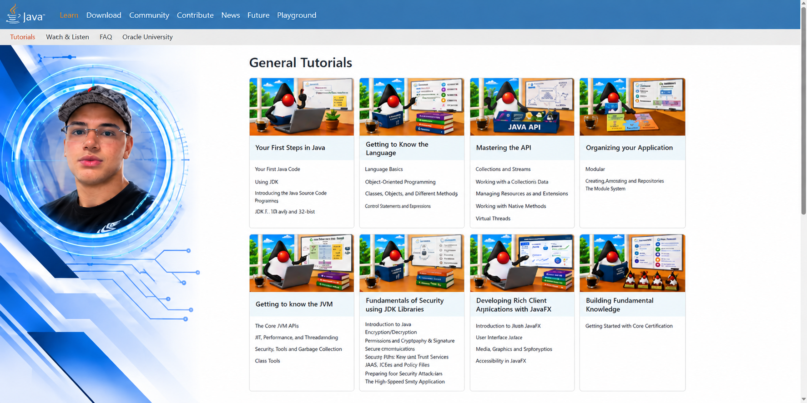

# Dev.java — Créditos e fontes de estudo

## 1. Sobre a fonte

O **Dev.java** é o portal oficial de aprendizado e documentação relacionado à linguagem Java.

Este espaço reúne os materiais utilizados como referência durante minha jornada de aprendizado, servindo como base para estudos, pesquisas e desenvolvimento de exercícios práticos.

## 2. Créditos

| Informação | Referência |
|---|---|
| Plataforma | Dev.java |
| Fonte | Portal oficial Java |
| Site | [dev.java](https://dev.java/) |
| Área de estudo | Desenvolvimento Java |
| Estudante | Gabriel Silva |

**Direitos e atribuições:** os conteúdos originais e materiais disponibilizados pertencem aos seus respectivos autores e responsáveis. Este repositório contém anotações, estudos e códigos desenvolvidos por mim, com indicação das fontes utilizadas.

## 3. Referências

Documentação e materiais utilizados como base para os estudos:

- [Dev.java — Portal oficial](https://dev.java/)
- [Learn Java — Tutoriais e aprendizado](https://dev.java/learn/)
- [Your First Steps in Java](https://dev.java/learn/first-steps/)
- [Java Language Basics](https://dev.java/learn/language-basics/)

## 4. Objetivo

Utilizar a documentação e os materiais oficiais do Dev.java para construir uma base sólida na linguagem Java.

Desenvolver conhecimentos fundamentais de programação, praticar a escrita de código, compreender os conceitos estudados e conquistar autonomia para desenvolver soluções próprias.

---

*Documentação pessoal de estudos — My-Studying-Java.*