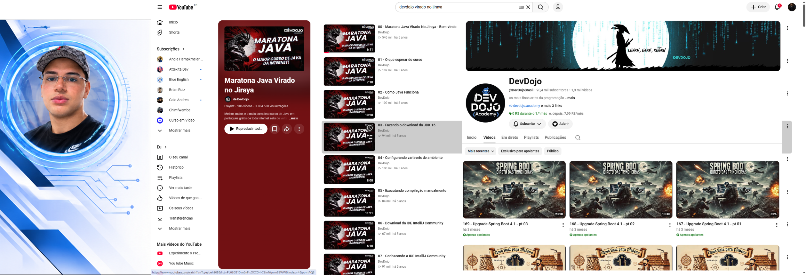

# DevDojo — Créditos e Fontes de Estudo

## 1. Sobre a fonte

O **DevDojo** é uma plataforma de ensino de programação que disponibiliza conteúdos gratuitos por meio de seu canal no YouTube e do site DevDojo Academy.

Esta pasta reúne os registros pessoais de estudo utilizando como referência o curso **Maratona Java — Virado no Jiraya**, disponibilizado pelo DevDojo.

## 2. Créditos

- **Plataforma:** DevDojo / DevDojo Academy
- **Instrutor e criador do curso:** William Suane
- **Edição dos vídeos:** Wildnei Suane
- **Curso:** Maratona Java — Virado no Jiraya

Todos os créditos do conteúdo original pertencem aos seus respectivos responsáveis.

## 3. Referências

- [Site oficial — DevDojo Academy](https://devdojo.academy/)
- [Canal oficial — DevDojo](https://www.youtube.com/@DevDojoBrasil)
- [Playlist — Maratona Java Virado no Jiraya](https://www.youtube.com/playlist?list=PL62G310vn6nFIsOCC0H-C2infYgwm8SWW)
- [Repositório oficial — DevDojo](https://github.com/devdojobr/maratona-java-virado-no-jiraya)

## 4. Objetivo

Esta pasta tem como objetivo organizar e documentar meus estudos de Java realizados por meio dos materiais disponibilizados pelo DevDojo.

Os códigos e demais registros serão organizados conforme o avanço dos estudos, preservando a referência ao material original e permitindo consultas futuras.

---

*Documentação pessoal de estudos — My-Studying-Java.*