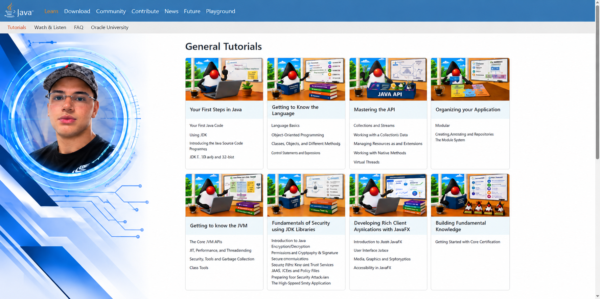
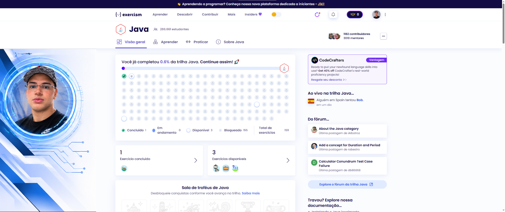
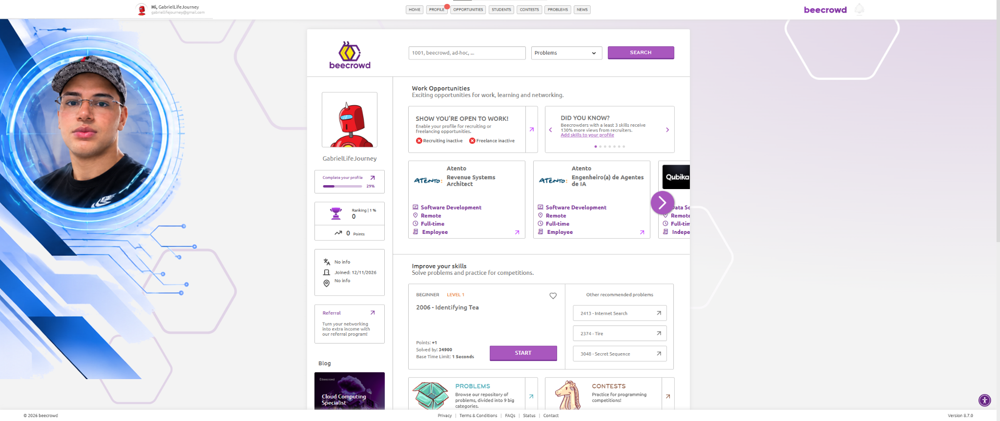

# My-Studying-Java

### Da lógica ao código: construindo minha evolução como desenvolvedor Java.

Este repositório documenta minha jornada de aprendizado em Java, reunindo códigos, exercícios, anotações e implementações desenvolvidas ao longo dos meus estudos.

Mais do que armazenar conteúdos, este projeto representa meu compromisso com a evolução técnica: compreender conceitos, investigar problemas, desenvolver soluções e aprender com cada experiência.

Meu objetivo é construir uma base sólida em programação, fortalecer meu raciocínio lógico e evoluir progressivamente para o desenvolvimento Backend.

> Aprender não é apenas reproduzir código. É compreender, questionar, praticar e evoluir.

---

## Sobre o projeto

O **My-Studying-Java** é meu espaço pessoal de estudos, prática e desenvolvimento na linguagem Java.

Aqui organizo conhecimentos adquiridos por meio de diferentes fontes de aprendizado, registrando exemplos, exercícios, implementações e descobertas realizadas durante minha formação.

Cada diretório representa uma etapa dessa jornada e mantém um histórico organizado do que estou estudando e desenvolvendo.

Este projeto está em constante evolução, assim como meu conhecimento.

---

## 🧠 Raciocínio técnico e tomada de decisão

### O que acontece por trás de cada linha de código?

Este repositório não existe apenas para armazenar códigos de aulas e exercícios. Quero também documentar como desenvolvo meu raciocínio, identifico dificuldades e tomo decisões durante a resolução de problemas.

Durante meus estudos com Java, percebi que aprender a programar vai muito além de reproduzir exemplos. É necessário compreender o que está acontecendo, questionar escolhas, investigar erros e entender por que determinada solução funciona.

**Não quero apenas saber como escrever um código. Quero entender por que ele funciona.**

### Como tomo minhas decisões de estudo

Um exemplo está na própria organização deste repositório.

Percebi que utilizar apenas uma fonte de aprendizado não atendia a todas as minhas necessidades. Por isso, decidi combinar diferentes plataformas, cada uma com uma finalidade específica:

- **Dev.java:** estudar fundamentos e consultar a documentação oficial.
- **DevDojo:** acompanhar explicações, exemplos e aplicações práticas.
- **Exercism:** praticar a resolução de problemas e receber feedback.
- **Beecrowd:** desenvolver lógica por meio de desafios de programação.

Essa escolha foi baseada na necessidade de complementar o aprendizado teórico com prática e resolução de problemas.

A intenção não é apenas consumir conteúdo, mas transformar conhecimento em capacidade de implementação.

### Perguntas que orientam meu aprendizado

Procuro desenvolver o hábito de questionar minhas próprias decisões durante os estudos.

| Pergunta | O que procuro compreender |
|---|---|
| Por que estou aprendendo este conceito? | Qual problema ele resolve e quando devo utilizá-lo? |
| Entendi ou apenas reproduzi o código? | Consigo explicar seu funcionamento com minhas próprias palavras? |
| Existe outra maneira de resolver? | Quais são as diferenças entre as possíveis soluções? |
| Por que meu código não funcionou? | Qual foi a causa do comportamento inesperado? |
| Como posso melhorar minha solução? | Existe uma maneira mais clara, organizada ou simples de implementar? |
| Como sei que a solução está correta? | Testei o código e verifiquei se o resultado corresponde ao esperado? |
| O que devo registrar em um commit? | Qual alteração foi realizada e qual foi sua finalidade? |
| O que aprendi com esse erro? | Como posso utilizar esse aprendizado em situações futuras? |

### Aprendizado aplicado ao código

Ao estudar Programação Orientada a Objetos, comecei a trabalhar com conceitos como classes, objetos, construtores, associação e herança.

Durante esse processo, procuro entender não apenas como escrever o código, mas também:

- Como os atributos são inicializados.
- Como os objetos são construídos e se relacionam.
- Como os dados são utilizados.
- Como funciona a sequência de inicialização.
- Como os conceitos se conectam na prática.

Quando encontro um comportamento diferente do esperado, considero isso uma oportunidade de investigação.

Procuro compreender a causa antes de simplesmente alterar o código. Dessa maneira, cada dificuldade pode se transformar em aprendizado.

### Versionamento e organização

Também considero o Git e o GitHub ferramentas importantes durante minha formação.

Estou aprendendo a utilizar o controle de versão para acompanhar minha evolução, organizar alterações e documentar o desenvolvimento dos projetos.

Algumas convenções que utilizo como referência:

- `feat`: inclusão de funcionalidades ou novos conteúdos.
- `fix`: correção de problemas.
- `docs`: alterações na documentação.

Meu objetivo é construir um histórico compreensível, no qual cada commit represente uma alteração com propósito definido.

### Meu critério de evolução

Quero desenvolver a capacidade de:

1. Compreender o problema antes de tentar resolvê-lo.
2. Investigar o comportamento do código.
3. Considerar diferentes alternativas.
4. Justificar minhas escolhas.
5. Implementar e testar uma solução.
6. Revisar o resultado e identificar melhorias.
7. Registrar o que aprendi durante o processo.

**Não espero ter todas as respostas enquanto estou aprendendo. Quero desenvolver a capacidade de fazer perguntas melhores, investigar com autonomia, reconhecer meus erros e justificar minhas decisões com evidências.**

Este repositório é o registro público dessa evolução.

---

## Organização do repositório

Atualmente, o projeto está dividido em quatro áreas principais:

### 01 — DevJava

Estudos dos fundamentos da linguagem Java, incluindo primeiros passos, configuração de ambientes de desenvolvimento e conceitos essenciais da linguagem.

**Conteúdos presentes:**

- Primeiros passos com Java.
- Configuração e utilização de IDEs.
- Visual Studio Code, IntelliJ IDEA e Eclipse.
- Variáveis e tipos primitivos.
- Operadores e expressões.
- Estruturas de controle.

[ Acessar pasta DevJava ](./01-DevJava/)

### 02 — DevDojo

Estudos baseados no curso **Maratona Java — Virado no Jiraya**, do DevDojo.

Esta seção reúne códigos desenvolvidos durante as aulas e materiais de apoio.

**Conteúdos presentes:**

- Estruturas de repetição.
- Arrays e arrays multidimensionais.
- Introdução à Orientação a Objetos.
- Classes e objetos.
- Exercícios e exemplos das aulas.

[ Acessar pasta DevDojo ](./02-DevDojo/)

### 03 — Exercism

Prática complementar utilizando a plataforma Exercism, com foco na resolução de problemas e no desenvolvimento do raciocínio lógico.

**Conteúdos presentes:**

- Exercícios de Java.
- Soluções desenvolvidas durante os estudos.
- Prática de lógica de programação.

[ Acessar pasta Exercism ](./03-Exercism/)

### 04 — Beecrowd

Área dedicada aos estudos e à resolução de desafios de programação da plataforma Beecrowd.

A estrutura inicial e a documentação de referência estão organizadas. As soluções serão adicionadas conforme o avanço das atividades.

[ Acessar pasta Beecrowd ](./04-Beedcrowd/)

---

## Fontes de aprendizado

Os estudos são realizados com apoio de plataformas, cursos e materiais educacionais.

| Plataforma | Finalidade |
|---|---|
| [DevDojo](https://www.youtube.com/@DevDojoBrasil) | Aulas e conteúdos de Java |
| [Dev.java](https://dev.java/) | Documentação e fundamentos oficiais |
| [Exercism](https://exercism.org/tracks/java) | Exercícios práticos e feedback |
| [Beecrowd](https://beecrowd.com/pt/) | Desafios de programação |

Os materiais e conteúdos de terceiros permanecem atribuídos aos seus respectivos autores e responsáveis. Os códigos e registros desenvolvidos por mim são organizados neste repositório para documentar meu aprendizado.

## Tecnologias e ferramentas

| Tecnologia ou ferramenta | Utilização |
|---|---|
| **Java** | Linguagem principal dos estudos |
| **IntelliJ IDEA** | Ambiente de desenvolvimento |
| **Git** | Controle de versão |
| **GitHub** | Hospedagem e documentação dos projetos |

## Progresso do projeto

Este repositório representa uma jornada de aprendizado em andamento.

Novos conteúdos, exercícios, anotações e projetos serão incorporados gradualmente.

A organização também poderá ser aprimorada à medida que novos assuntos forem estudados.

Mais importante do que a quantidade de conteúdos registrados é a capacidade de compreender, aplicar e evoluir com o conhecimento adquirido.

## Objetivos

Meus objetivos durante essa jornada são:

- Consolidar os fundamentos da linguagem Java.
- Desenvolver raciocínio lógico e capacidade de resolução de problemas.
- Aprofundar os conhecimentos em Programação Orientada a Objetos.
- Resolver exercícios de diferentes níveis de dificuldade.
- Aprender boas práticas de desenvolvimento.
- Desenvolver projetos próprios.
- Evoluir na utilização de Git e GitHub.
- Construir um histórico público e organizado da minha evolução como desenvolvedor.
- Preparar uma base técnica consistente para atuar com desenvolvimento Backend.

---

## Direitos autorais

Copyright (c) 2026 Gabriel Silva.

**All Rights Reserved.**

O código-fonte e os materiais originais desenvolvidos neste projeto são protegidos por direitos autorais. Nenhuma autorização geral de uso, cópia, modificação ou distribuição é concedida.

Os conteúdos de terceiros permanecem sob os direitos e licenças de seus respectivos proprietários.

Consulte o arquivo [LICENSE](./LICENSE) para conhecer o aviso completo.

---

**Projeto:** My-Studying-Java  
**Autor:** Gabriel Silva  
**Área de interesse:** Desenvolvimento Backend  
**Status:** Em desenvolvimento  
**Repositório:** [GitHub — My-Studying-Java](https://github.com/GabrielLifeJourney/My-Studying-Java)

## 👤 Autor

  
   
  <strong>Gabriel Silva</strong>
   
  <a href="https://github.com/GabrielLifeJourney">Meu GitHub</a>

