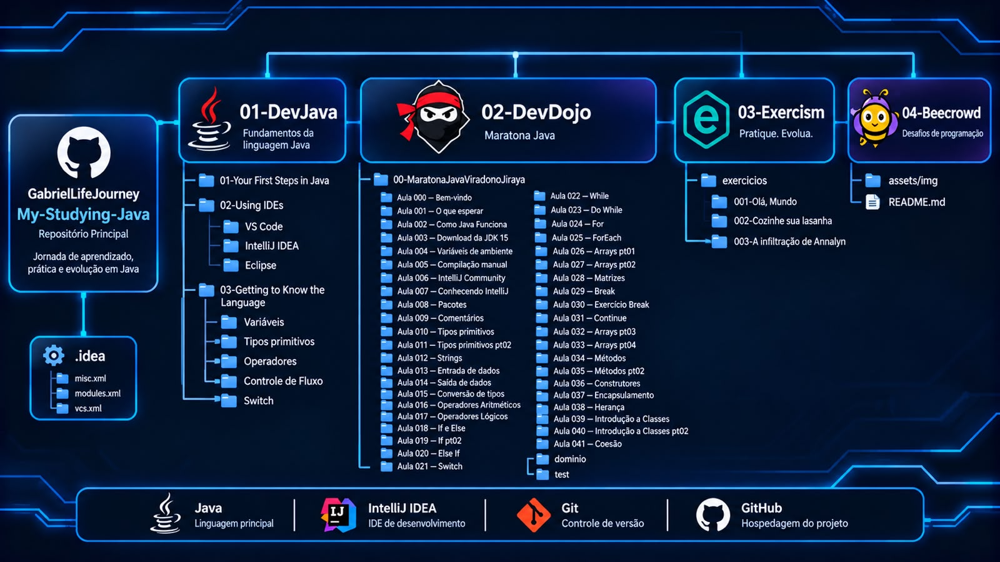
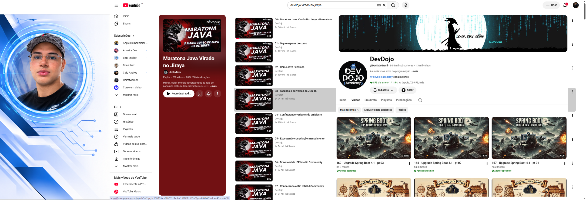

# My-Studying-Java

**Minha jornada de aprendizado, prática e evolução em Java.**

Este repositório documenta minha trajetória no desenvolvimento Java, reunindo códigos, exercícios, anotações e materiais organizados durante meus estudos.

O objetivo é construir uma base sólida em programação, desenvolver o raciocínio lógico e acompanhar minha evolução por meio da prática constante.

> Aprender, praticar, documentar e evoluir.

---

## Sobre o projeto

O **My-Studying-Java** é meu espaço pessoal de estudos e desenvolvimento em Java.

Aqui organizo conteúdos de diferentes fontes de aprendizado, registrando exemplos, exercícios e implementações realizadas durante minha formação.

Este repositório está em desenvolvimento e será atualizado conforme meu progresso nos estudos.

## Organização do repositório

Atualmente, o projeto está dividido em quatro áreas principais:

### 01 — DevJava

Estudos dos fundamentos da linguagem Java, incluindo primeiros passos, configuração de ambientes de desenvolvimento e conceitos da linguagem.

**Conteúdos presentes:**
- Primeiros passos com Java.
- Configuração e utilização de IDEs.
- Visual Studio Code, IntelliJ IDEA e Eclipse.
- Variáveis e tipos primitivos.
- Operadores e expressões.
- Estruturas de controle.

[ Acessar pasta DevJava ](01-DevJava/)

### 02 — DevDojo

Estudos baseados no curso **Maratona Java — Virado no Jiraya**, do DevDojo.

Esta seção reúne códigos desenvolvidos durante as aulas e materiais de apoio.

**Conteúdos presentes:**
- Estruturas de repetição.
- Arrays e arrays multidimensionais.
- Introdução à orientação a objetos.
- Classes e objetos.
- Exercícios e exemplos das aulas.

[ Acessar pasta DevDojo ](02-DevDojo/)

### 03 — Exercism

Prática complementar utilizando a plataforma Exercism, com foco na resolução de problemas e no desenvolvimento do raciocínio lógico.

**Conteúdos presentes:**
- Exercícios de Java.
- Soluções desenvolvidas durante os estudos.
- Prática de lógica de programação.

[ Acessar pasta Exercism ](03-Exercism/)

### 04 — Beecrowd

Área reservada para estudos e resolução de desafios de programação da plataforma beecrowd.

A estrutura inicial e a documentação de referência já estão organizadas. As soluções serão adicionadas conforme o avanço das atividades.

[ Acessar pasta Beecrowd ](04-Beedcrowd/)

---

## Fontes de aprendizado

Os estudos são realizados com apoio de plataformas e materiais educacionais:

| Plataforma | Finalidade |
|---|---|
| [DevDojo](https://www.youtube.com/@DevDojoBrasil) | Aulas e conteúdos de Java |
| [DevJava](https://dev.java/) | Documentação e fundamentos oficiais |
| [Exercism](https://exercism.org/tracks/java) | Exercícios práticos |
| [Beecrowd](https://beecrowd.com/pt/) | Desafios de programação |

Os materiais e conteúdos de terceiros permanecem atribuídos aos seus respectivos autores e responsáveis. Os códigos e registros desenvolvidos por mim são organizados neste repositório para documentar meu aprendizado.

## Tecnologias e ferramentas

- **Linguagem:** Java
- **IDE:** IntelliJ IDEA
- **Controle de versão:** Git
- **Hospedagem do código:** GitHub

## Progresso do projeto

Este repositório representa uma jornada de aprendizado em andamento.

Novos conteúdos, exercícios, anotações e projetos serão incorporados gradualmente.

A organização também poderá ser aprimorada à medida que novos assuntos forem estudados.

## Objetivos

- Consolidar os fundamentos da linguagem Java.
- Desenvolver raciocínio lógico e resolução de problemas.
- Praticar orientação a objetos.
- Resolver exercícios de diferentes níveis.
- Desenvolver projetos próprios.
- Construir um histórico público e organizado da minha evolução como desenvolvedor.

## Direitos autorais

Copyright (c) 2026 Gabriel Silva.

**All Rights Reserved.**

O código-fonte e os materiais originais desenvolvidos neste projeto são protegidos por direitos autorais. Nenhuma autorização geral de uso, cópia, modificação ou distribuição é concedida.

Consulte o arquivo [LICENSE](LICENSE) para conhecer o aviso completo.

---

**Projeto:** My-Studying-Java  
**Autor:** Gabriel Silva  
**Status:** Em desenvolvimento  
**Repositório:** [GitHub — My-Studying-Java](https://github.com/GabrielLifeJourney/My-Studying-Java)

## 👤 Autor

  
   
  <strong>Gabriel Silva</strong>
   
  <a href="https://github.com/GabrielLifeJourney">Meu GitHub</a>

